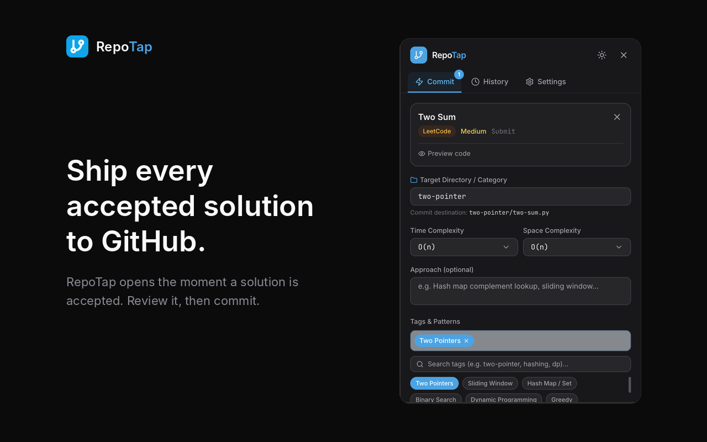
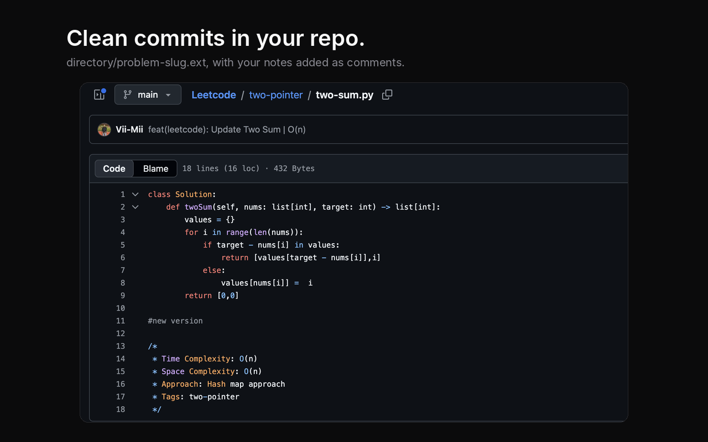

# RepoTap Chrome Extension

> Commit your LeetCode, HackerRank & GeeksForGeeks accepted solutions to GitHub — structured, annotated, on your terms.

<p>
  
  
</p>

## Features
- 🚀 Popup opens automatically when a solution is accepted (LeetCode, HackerRank, GeeksForGeeks)
- ✅ Commit it, or ✕ dismiss it — nothing is pushed without your say-so
- 📁 Simple layout: `<repo>/<directory>/<problem-slug>.<ext>` (e.g. `two-pointer/two-sum.py`)
- 📝 Just the solution; time & space complexity, approach and tags are appended as comments (only if provided)
- 🔄 Existing file: **Override** it, or **Append New Version** below a long separator line
- 🏷️ 60+ tags & patterns (two-pointer, hashing, dp, …); the first tag suggests the directory
- 🌗 Dark / Light theme

## User Guide

### 1. Install
- **Chrome Web Store:** coming soon — the link will be added here once it is live.
- **From source:**
  1. `npm install && npm run build`
  2. Open `chrome://extensions`, turn on **Developer mode**, click **Load unpacked** and pick the `dist` folder.

Tip: pin RepoTap (puzzle-piece icon → pin) so the badge counter is always visible.

### 2. Connect GitHub (one time)
1. Create a GitHub repo for your solutions, e.g. `your-name/leetcode`.
2. Create a token at GitHub → Settings → Developer settings → Personal access tokens → **Fine-grained tokens**:
   - Repository access: *Only select repositories* → your solutions repo
   - Permissions: **Contents → Read and write** (nothing else)
3. Open RepoTap → **Settings** and fill in:
   - **Token** – the token from above
   - **Repository** – `your-name/leetcode`
   - **Branch** – e.g. `main`
   - **Base directory** *(optional)* – leave empty to start at the repo root
4. Click **Save Settings**.

### 3. Solve and commit
1. Solve a problem on LeetCode, HackerRank or GeeksForGeeks and submit it.
2. When the verdict is *Accepted / Problem Solved Successfully*, RepoTap opens by itself and the toolbar icon shows a counter of unsaved solutions.
3. In the **Commit** tab:
   - **Target Directory** – the folder to save into, e.g. `two-pointer` (picking a tag suggests one)
   - **Time / Space complexity, Approach, Tags** – all optional
   - **If the file already exists** – *Override* replaces it; *Append New Version* keeps the old code and adds the new one below a long separator line
4. Click **Commit Solution**, or **✕ / Dismiss** to discard it. Nothing is pushed until you commit.

### 4. What gets committed
For repo `vii-mii/leetcode`, directory `two-pointer`, problem *Two Sum* (Python):

```
vii-mii/leetcode/two-pointer/two-sum.py
```

The file contains only the solution, followed by commented-out notes (only the ones you filled in):

```python
def twoSum(nums, target):
    ...

# Time Complexity: O(n)
# Space Complexity: O(n)
# Approach: Hash map of complements
# Tags: hashing, array
```

Appending a new version adds a `# ----…----` / `# Next Solution Version` divider and the new solution plus its notes underneath.

### Troubleshooting
- **Nothing detected:** reload RepoTap in `chrome://extensions`, then refresh the problem tab.
- **Commit fails:** check the token has *Contents: Read and write* on that repo, and that the repo/branch names are correct.
- **Popup didn't open on its own:** Chrome sometimes blocks this; click the RepoTap icon or the desktop notification.

### Privacy
RepoTap has no backend. Your token and settings are stored in Chrome's local extension storage and are only sent to `api.github.com`. Solution code is read from the problem page only after an accepted submission. Full details: [PRIVACY.md](PRIVACY.md).

## Tech Stack
- Manifest V3 + Chrome APIs
- React 18 + Vite
- Tailwind CSS (dark mode)
- GitHub REST API (direct, no backend)

## License
[MIT](LICENSE)

RepoTap is an independent project and is not affiliated with or endorsed by LeetCode, HackerRank, GeeksforGeeks or GitHub.
